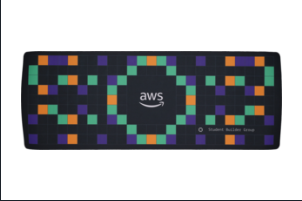
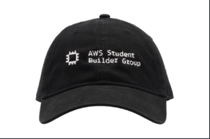
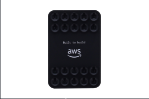

<h1>Cloud Detective</h1>

  
  
  

  

## Rewards

<table align="center">
  <tr>
    <td align="center"> <strong>1º lugar</strong> Desk Mat</td>
    <td align="center"> <strong>2º lugar</strong> Cotton Twill Cap</td>
    <td align="center"> <strong>3º lugar</strong> Magnetic Phone Accessory</td>
  </tr>
</table>

Brindes sujeitos à confirmação da <a href="https://github.com/awsbuildersuffs">AWS Student Builder Group UFFS</a>

## Follow us

  
  
  
  
  
  

