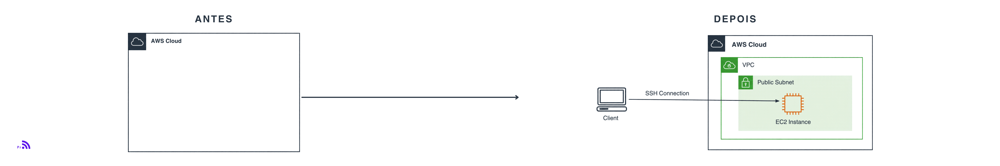

<h2>Amazon EC2 | Hands-on Lab</h2>

  Aprenda a criar, acessar e gerenciar sua primeira instância Linux na AWS

## Arquitetura do laboratório

  

## Etapas

  <a href="steps/01-aws-console/">
    <strong>Iniciar laboratório →</strong>
  </a>

