<p align="center">
  <a href="../../README.md"></a>
</p>

<div align="center">
<h2>05 · Acesso público no Amazon S3</h2>

<a href="../console/README.md"></a>
<a href="../bucket/README.md"></a>
<a href="../folder/README.md"></a>
<a href="../upload/README.md"></a>

<a href="../metadata/README.md"></a>
<a href="../delete/README.md"></a>

</div>

## Visão geral

Por padrão, os objetos armazenados no Amazon S3 são privados

Nesta etapa, vamos testar o acesso a um arquivo e permitir a leitura pública dos objetos do bucket

> **Atenção:** a política desta etapa permite que qualquer pessoa leia todos os objetos do bucket. Use somente um bucket de laboratório, sem dados privados ou importantes, e remova a política ao concluir

## Instruções

### 1. Teste o acesso ao objeto

Abra seu bucket e acesse `cloud-folder/`


Selecione o arquivo enviado anteriormente e abra a aba **Properties**

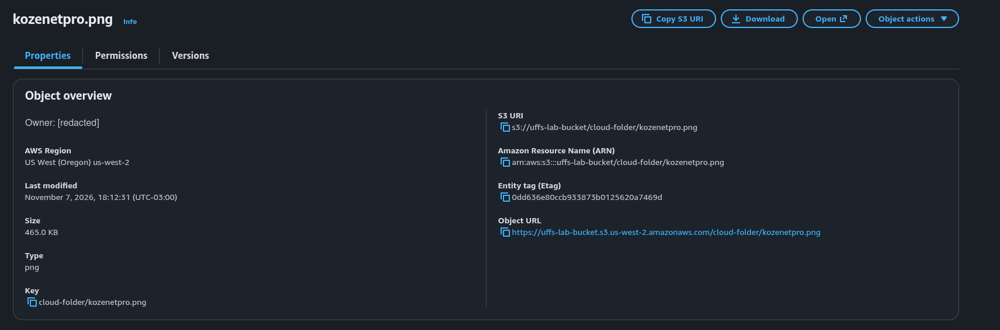

Copie **Object URL** e abra o endereço em uma nova aba

O navegador deverá apresentar **AccessDenied**, indicando que o arquivo ainda não está público

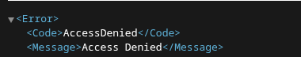

### 2. Configure as permissões

Retorne ao bucket e abra a aba **Permissions**

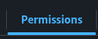

Em **Block public access (bucket settings)**, clique em **Edit**

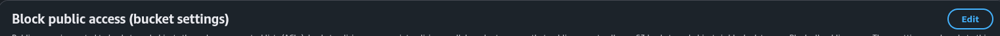

Desmarque **Block all public access**. O Console pode desmarcar automaticamente as quatro opções individuais

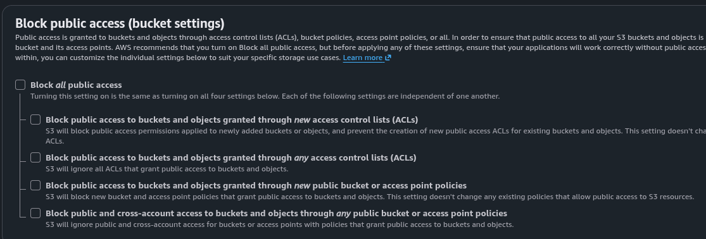

Antes de salvar, marque novamente as duas opções relacionadas a ACLs públicas:

- Block public access to buckets and objects granted through new access control lists (ACLs)
- Block public access to buckets and objects granted through any access control lists (ACLs)

Deixe desmarcadas somente as duas opções relacionadas a políticas públicas do bucket. Isso mantém o acesso público por ACL bloqueado e permite usar a política restrita ao objeto abaixo

Clique em **Save changes**

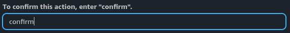

Digite `confirm` e clique em **Confirm**


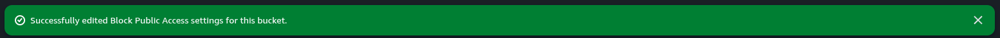

> Faça essa configuração somente em um bucket de laboratório, com arquivos de teste e autorização da equipe

### 3. Crie uma política de leitura pública para os objetos do bucket

Na aba **Permissions**, localize **Bucket policy** e clique em **Edit**

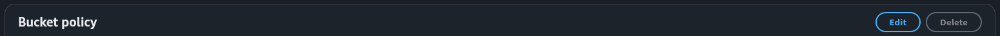

Copie o **Bucket ARN** exibido nas propriedades do bucket

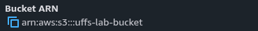

A política abaixo usa `BUCKET_ARN/*` no campo **Resource**. Substitua `BUCKET_ARN` pelo ARN copiado, mantendo `/*` no final. Esse curinga permite leitura de todos os objetos do bucket

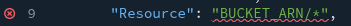

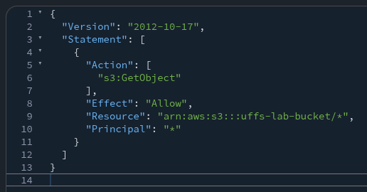

Copie e cole esta política. Troque `BUCKET_ARN` pelo ARN real do seu bucket:

```json
{
  "Version": "2012-10-17",
  "Statement": [
    {
      "Sid": "PublicReadBucketObjects",
      "Effect": "Allow",
      "Principal": "*",
      "Action": "s3:GetObject",
      "Resource": "BUCKET_ARN/*"
    }
  ]
}
```

A permissão `s3:GetObject` com `/*` permite a leitura de qualquer objeto do bucket

Confira se substituiu `BUCKET_ARN` pelo ARN correto e manteve `/*` ao final. Não use esta política em buckets com conteúdo que não deve ser público

Clique em **Save changes**

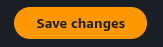

### 4. Teste novamente

Retorne à aba onde apareceu **AccessDenied** e atualize a página

Se a política estiver correta, o objeto de teste será exibido sem solicitar login na AWS


## Verificação

Confirme que o Object URL abre em uma janela anônima, sem autenticação na AWS

<details>
<summary>O acesso continua negado?</summary>

Confira se o nome do bucket e a chave do objeto correspondem à política

Verifique também se há bloqueios de acesso público definidos no nível da conta AWS, pois eles podem prevalecer sobre as configurações do bucket

Não desative proteções no nível da conta sem autorização da equipe

</details>

<details>
<summary>Concluiu esta etapa? 🎉</summary>

<div align="center">


Você configurou e testou a leitura pública dos objetos do bucket de laboratório

</div>

</details>

## Remova o acesso público após o teste

Depois de concluir o teste:

1. Em **Permissions → Bucket policy**, exclua a política pública criada
2. Em **Block public access (bucket settings) → Edit**, marque **Block all public access**
3. Salve a alteração e confirme quando o Console solicitar

Não deixe o bucket de laboratório público. Para disponibilizar arquivos na internet em projetos reais, prefira Amazon CloudFront com acesso privado ao S3

---

<table width="100%">
  <tr>
    <td><a href="../upload/README.md"></a></td>
    <td align="right"><a href="../metadata/README.md"></a></td>
  </tr>
</table>
