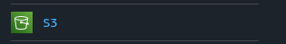
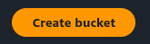
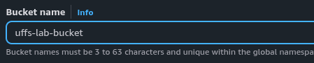
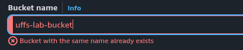
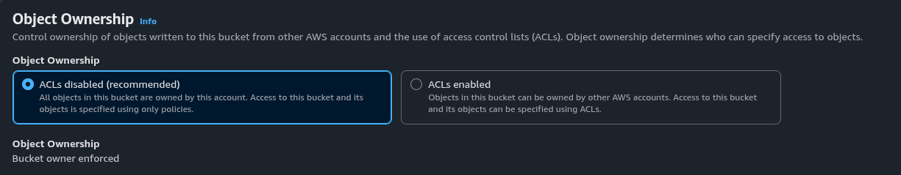
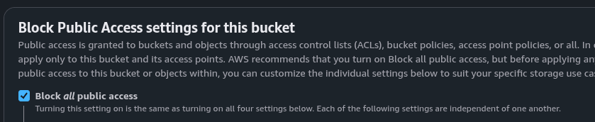
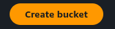
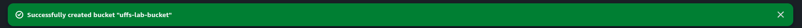

<p align="center">
  <a href="../../README.md"></a>
</p>

<div align="center">
<h2>02 · Criando um bucket Amazon S3</h2>

<a href="../console/README.md"></a>

<a href="../folder/README.md"></a>
<a href="../upload/README.md"></a>
<a href="../access/README.md"></a>
<a href="../metadata/README.md"></a>
<a href="../delete/README.md"></a>

</div>

## Visão geral

O Amazon S3 é um serviço de armazenamento de objetos na nuvem

Nesta etapa, vamos criar um bucket e conhecer suas principais configurações

## Instruções

### 1. Acesse o Amazon S3

No AWS Console, pesquise por **S3** e selecione o serviço



No painel do S3, clique em **Create bucket**



### 2. Escolha um nome único

Em **Bucket name**, informe um nome, por exemplo:

```text
uffs-s3-lab-123abc
```

O nome precisa ser único entre todos os buckets da mesma partição AWS. Se ele já estiver em uso, escolha outro nome acrescentando uma combinação própria de letras e números



Se aparecer o aviso **Bucket with the same name already exists**, escolha outro nome e tente novamente



O nome do bucket deve:

- Ser único entre todos os buckets da mesma partição AWS
- Ter entre 3 e 63 caracteres
- Utilizar letras minúsculas, números, pontos ou hífens
- Não ter formato de endereço IP

Confirme que a região selecionada corresponde à região definida para o laboratório

### 3. Mantenha as configurações de segurança padrão

Na seção **Object Ownership**, mantenha a opção padrão:

**ACLs disabled (recommended)**



Em **Block Public Access settings for this bucket**, mantenha:

**Block all public access** ativado



Essas configurações ajudam a evitar a exposição acidental de arquivos

Não altere o bloqueio de acesso público nesta etapa. As instruções do laboratório indicarão se e quando será necessário modificá-lo

### 4. Crie o bucket

Revise as configurações e clique no botão **Create bucket** no final da página



Aguarde a confirmação de que o bucket foi criado



### 5. Confira o bucket criado

Na lista de buckets, clique no nome do bucket criado

Abra a aba **Properties** para visualizar suas configurações

Nenhuma alteração é necessária por enquanto

## Verificação

Confirme que o bucket aparece na lista de buckets e que suas propriedades estão acessíveis

<details>
<summary>Concluiu esta etapa? 🎉</summary>

<div align="center">


Seu bucket está pronto para receber arquivos

</div>

</details>

---

<table width="100%">
  <tr>
    <td><a href="../console/README.md"></a></td>
    <td align="right"><a href="../folder/README.md"></a></td>
  </tr>
</table>
