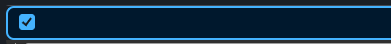
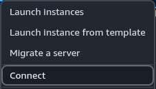
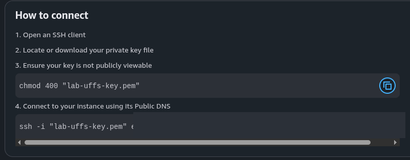
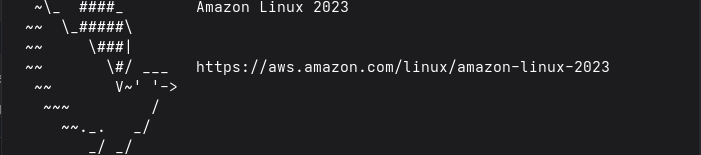

<p align="center">
  <a href="../../README.md"></a>
</p>

<div align="center">

<h2>03 · Conectando à instância EC2</h2>

<a href="../console/README.md"></a>
<a href="../launch/README.md"></a>

<a href="../metadata/README.md"></a>
<a href="../terminate/README.md"></a>

</div>

## Visão geral

O AWS Console mostra os dados necessários para conectar à instância com um cliente SSH local

Nesta etapa, vamos localizar a instância, abrir a tela de conexão e acessar o servidor Linux

## Instruções

### 1. Localize sua instância

No painel do EC2, acesse **Instances**

Selecione a instância criada, confirme que ela está em **Running** e aguarde a aprovação dos **Status checks**



### 2. Abra a conexão

Com a instância selecionada, abra o menu **Connect**



### 3. Consulte as instruções SSH

Na janela **Connect to instance**, abra a aba **In SSH client**



Confirme o nome do par de chaves e use o usuário padrão do Amazon Linux:

`ec2-user`

O Console exibe o DNS público e um comando SSH para a instância. Esses valores são específicos da sua instância; use os que aparecem na sua própria tela e não publique endereços reais

### 4. Conecte-se pelo terminal local

Abra um terminal no computador onde está o arquivo de chave baixado durante a etapa anterior. No Linux ou macOS, ajuste as permissões da chave:

```bash
chmod 400 "lab-uffs-key.pem"
```

Execute o comando apresentado na aba **In SSH client**. Ele terá este formato; substitua `DNS-PUBLICO-DA-INSTANCIA` pelo DNS público exibido no Console:

```bash
ssh -i "lab-uffs-key.pem" ec2-user@DNS-PUBLICO-DA-INSTANCIA
```

Na primeira conexão, o SSH exibirá a impressão digital do servidor e pedirá confirmação. Se não puder validá-la com uma fonte confiável, como a equipe do laboratório, não aceite a conexão. Quando a conexão for estabelecida, o terminal mostrará o ambiente Amazon Linux:



## Verificação

O prompt do terminal deve indicar que você está conectado como `ec2-user` à instância e pronto para executar comandos

<details>
<summary>Não conseguiu conectar?</summary>

Confira se a instância está em execução, se o usuário informado é `ec2-user` e se o arquivo `.pem` corresponde ao par de chaves selecionado ao criar a instância

Verifique se o grupo de segurança permite SSH pela porta **22** a partir do seu IP e se a instância tem conectividade de rede

No Linux ou macOS, confirme também que a chave tem permissões restritas, como no comando `chmod 400` acima

</details>

<details>
<summary>Concluiu esta etapa? 🎉</summary>

<div align="center">


Seu servidor Linux está pronto para receber comandos

</div>

</details>

---

<table width="100%">
  <tr>
    <td><a href="../launch/README.md"></a></td>
    <td align="right"><a href="../metadata/README.md"></a></td>
  </tr>
</table>
