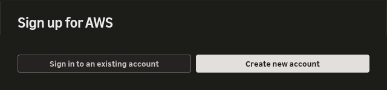
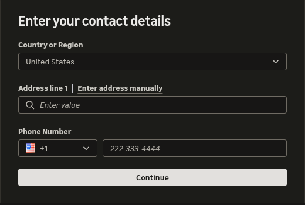

  

<h2>01 · Acessando o AWS Console</h2>

## Visão geral

Nesta etapa, vamos acessar a conta AWS e abrir o console para os laboratórios EC2 e S3

## Instruções

### 1. Entre ou crie uma conta

Abra o link de acesso indicado pela organização

Se você já tem uma conta AWS, escolha **Sign in to an existing account**

Se a organização orientou você a criar uma conta, entre com seu AWS Builder ID e escolha **Create new account**

### 2. Complete a configuração da conta

Selecione seu país, preencha seus próprios dados e conclua as verificações na tela. A captura é apenas um exemplo. Não compartilhe senhas ou códigos de verificação

> A criação da conta pode solicitar informações pessoais e de cobrança. Revise as condições atuais da AWS antes de continuar. Recursos usados na conta podem gerar cobranças

Se a organização fornecer uma conta temporária, use as instruções recebidas em vez de criar uma conta pessoal

### 3. Acesse o AWS Console

Após a configuração, entre no console com o método indicado para sua conta

Abra o seletor de regiões no canto superior direito e selecione a região indicada pela organização

O acesso ao console e a seleção da região são iguais para os laboratórios EC2 e S3

## Verificação

Confirme que o AWS Console está aberto na região indicada pela organização

Concluiu esta etapa? 🎉

Seu ambiente está pronto para a próxima etapa

---

<table width="100%">
  <tr>
    <td></td>
    <td align="right"></td>
  </tr>
</table>