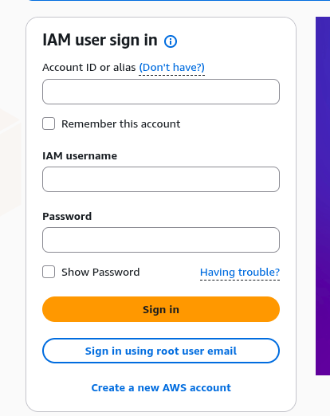
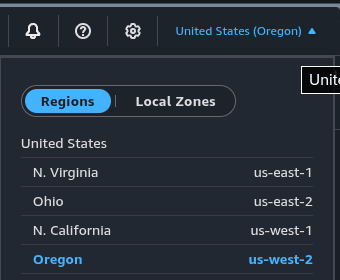
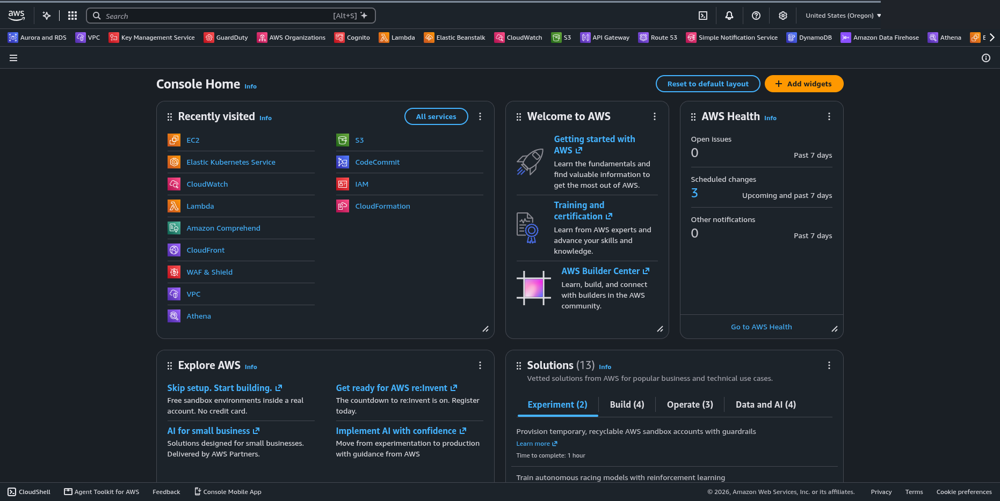

  

<h2>01 · Acessando o AWS Console</h2>

## Visão geral

O AWS Management Console é a interface web utilizada para acessar e gerenciar os serviços da AWS

Nesta etapa, vamos entrar no ambiente do laboratório e selecionar a região correta

## Instruções

### 1. Acesse o ambiente AWS

Abra o link de acesso disponibilizado pela equipe do laboratório

Se estiver utilizando uma conta temporária, siga as orientações de acesso recebidas

### 2. Faça login

Na página de autenticação, informe as credenciais fornecidas para sua sessão e clique em **Sign in**

### 3. Selecione a região

No canto superior direito do console, abra o seletor de regiões

Para o laboratório de referência, selecione **US West (Oregon) — us-west-2**

> Utilize a região informada pela equipe caso seja diferente da referência

## Verificação

Confirme que o AWS Console está acessível e que a região selecionada corresponde à do laboratório

Concluiu esta etapa? 🎉

Seu ambiente está pronto para a próxima etapa

---

<table width="100%">
  <tr>
    <td></td>
    <td align="right"></td>
  </tr>
</table>