<p align="center">
  <a href="../../README.md">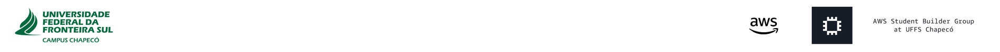</a>
</p>

<div align="center">
<h2>07 · Excluindo um bucket S3</h2>

<a href="../console/README.md"></a>
<a href="../bucket/README.md"></a>
<a href="../folder/README.md"></a>
<a href="../upload/README.md"></a>
<a href="../access/README.md"></a>
<a href="../metadata/README.md"></a>


</div>

## Visão geral

O Amazon S3 permite excluir buckets e seus objetos quando não são mais necessários

Nesta etapa, vamos esvaziar e excluir somente o bucket criado durante o laboratório

> **Atenção:** esta operação é destrutiva e não pode ser desfeita. Confirme cuidadosamente o nome do bucket e verifique que não há arquivos importantes antes de continuar

## Instruções

### 1. Localize o bucket

No AWS Management Console, pesquise por **S3** e abra o serviço

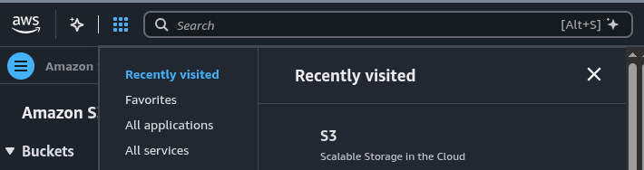

Na página **Buckets**, selecione o bucket criado anteriormente


Confira o nome do bucket selecionado antes de prosseguir

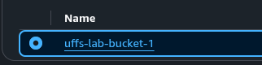

### 2. Esvazie o bucket

Com o bucket selecionado, clique em **Empty**

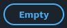

Na tela de confirmação, digite:

```text
permanently delete
```

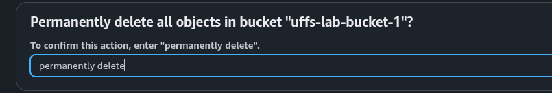

Clique em **Empty** para confirmar a exclusão dos objetos

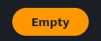

Aguarde a confirmação de que o bucket foi esvaziado

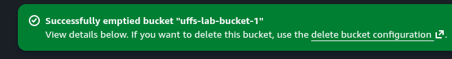

Clique em **Exit** para retornar à lista de buckets

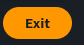

### 3. Exclua o bucket

Selecione novamente o bucket vazio e clique em **Delete**

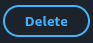

Na tela de confirmação, digite o **nome exato do seu bucket**

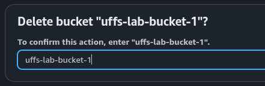

Confira o nome digitado e clique em **Delete bucket** para finalizar

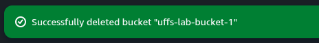

> Após a exclusão, o nome do bucket poderá ser utilizado por outra conta AWS

## Verificação

Retorne à página **Buckets** e confirme que o bucket excluído não aparece mais na lista

Se a exclusão falhar, confirme que todos os objetos foram removidos e que você selecionou o bucket correto

<details>
<summary>Concluiu o laboratório? 🎉</summary>

<div align="center">


<h3>Mission accomplished!</h3>

Você concluiu o laboratório Amazon S3 e explorou a criação de buckets, organização de objetos, upload de arquivos, permissões, metadados e exclusão de recursos

<p>
  <a href="https://github.com/rubemoon/aws-hands-on-ec2-s3/tree/challenge">
    
  </a>
</p>

</div>

</details>

---

<table width="100%">
  <tr>
    <td><a href="../metadata/README.md"></a></td>
    <td align="right"></td>
  </tr>
</table>
