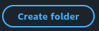
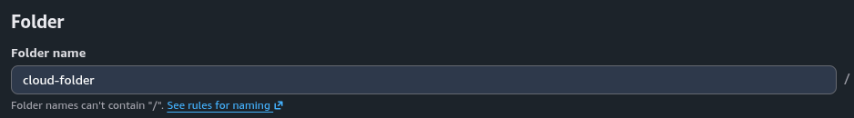
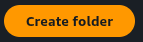

<p align="center">
  <a href="../../README.md"></a>
</p>

<div align="center">
<h2>03 · Criando uma pasta no Amazon S3</h2>

<a href="../console/README.md"></a>
<a href="../bucket/README.md"></a>

<a href="../upload/README.md"></a>
<a href="../access/README.md"></a>
<a href="../metadata/README.md"></a>
<a href="../delete/README.md"></a>

</div>

## Visão geral

O Amazon S3 permite organizar objetos utilizando pastas

Diferentemente de um sistema de arquivos tradicional, as pastas no S3 representam prefixos dos nomes dos objetos

Nesta etapa, vamos criar uma pasta dentro do bucket

## Instruções

### 1. Acesse seu bucket

No AWS Console, abra **S3 → Buckets**

Selecione o bucket criado na etapa anterior e acesse a aba **Objects**

### 2. Crie uma pasta

Clique em **Create folder**



No campo **Folder name**, informe:

```text
cloud-folder
```



Mantenha as demais configurações padrão e clique em **Create folder**



### 3. Verifique a pasta

Após a criação, o Console retornará à aba **Objects**

A pasta `cloud-folder/` deverá aparecer na lista

Clique na pasta para confirmar que ela pode ser acessada

## Verificação

Confirme que a pasta `cloud-folder/` aparece dentro do bucket e pode ser acessada

<details>
<summary>Concluiu esta etapa? 🎉</summary>

<div align="center">


Sua pasta está pronta para receber arquivos

</div>

</details>

---

<table width="100%">
  <tr>
    <td><a href="../bucket/README.md"></a></td>
    <td align="right"><a href="../upload/README.md"></a></td>
  </tr>
</table>
