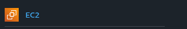
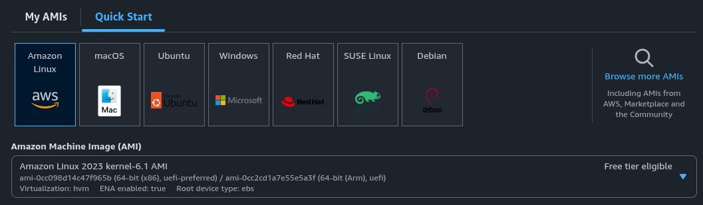
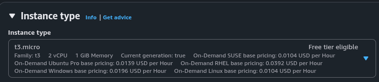
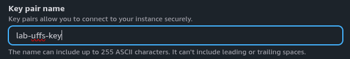
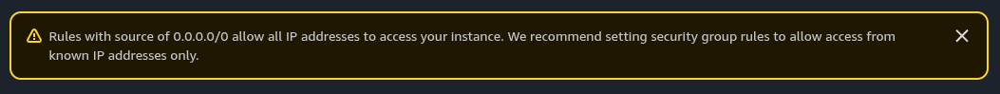
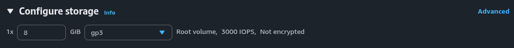
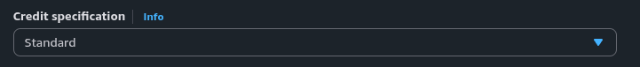
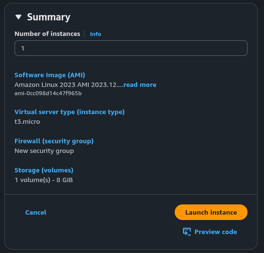
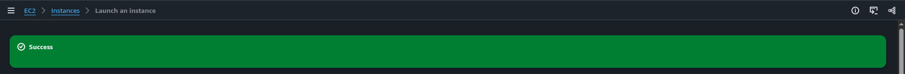
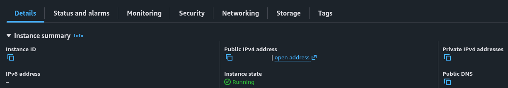

  

<h2>02 · Criando uma instância EC2</h2>

## Visão geral

O Amazon EC2 permite criar servidores virtuais na nuvem

Nesta etapa, vamos configurar e iniciar uma instância Linux usando o AWS Management Console

## Instruções

### 1. Acesse o Amazon EC2

No console AWS, use a busca para localizar **EC2** ou clique no atalho do serviço, quando estiver disponível

No painel do EC2, clique em **Launch instance**

### 2. Configure a instância

Em **Name and tags**, informe um nome para identificar seu servidor, se desejar

Na seção **Application and OS Images**, selecione **Amazon Linux 2023**

Em **Instance type**, escolha **t3.micro**, conforme o laboratório de referência

### 3. Crie o par de chaves

Em **Key pair**, clique em **Create new key pair**

Em **Key pair name**, informe:

`lab-uffs-key`

Selecione o formato `.pem` para acesso SSH e clique em **Create key pair**

O navegador fará o download de `lab-uffs-key.pem`. Guarde o arquivo em local seguro. Não copie o conteúdo da chave privada para o README, mensagens ou GitHub

### 4. Configure a rede e o armazenamento

Na seção **Network settings**, verifique as configurações de rede da instância

Para conexões SSH externas, utilize a porta **22** e restrinja a origem a **My IP** sempre que possível

As capturas seguintes mostram a opção **Anywhere** (`0.0.0.0/0`) e o aviso de segurança exibido pela AWS. Essa configuração permite tentativas de conexão de qualquer endereço IP; use-a somente se as instruções do laboratório exigirem e pelo menor tempo possível

Em **Configure storage**, utilize os valores de referência:

| Recurso | Configuração |
|---|---|
| Volume raiz | 8 GiB |
| Tipo de volume | gp3 |

### 5. Revise as opções avançadas

Se a seção **Advanced details** estiver disponível, revise as opções antes de iniciar

No ambiente de referência, **Credit specification** está definida como **Standard**

Essa configuração pode variar conforme o tipo de instância e as regras do laboratório

Mantenha as demais configurações autorizadas pela equipe

### 6. Inicie a instância

Revise o painel **Summary**, verificando:

- Quantidade de instâncias: `1`
- AMI: Amazon Linux 2023
- Tipo: `t3.micro`
- Par de chaves selecionado
- Rede e armazenamento configurados

Se tudo estiver correto, clique em **Launch instance**

Aguarde a mensagem de sucesso. Em seguida, use o caminho de navegação no topo da página e clique em **Instances** para abrir a lista de instâncias

## Verificação

Na lista, selecione a instância criada e confira:

- **Instance state:** Running
- **Instance ID:** identificador da instância
- **Public IPv4:** endereço público, quando atribuído
- **Status checks:** verificações de funcionamento

Concluiu esta etapa? 🎉

Seu servidor está pronto para a próxima etapa

---

<table width="100%">
  <tr>
    <td></td>
    <td align="right"></td>
  </tr>
</table>
