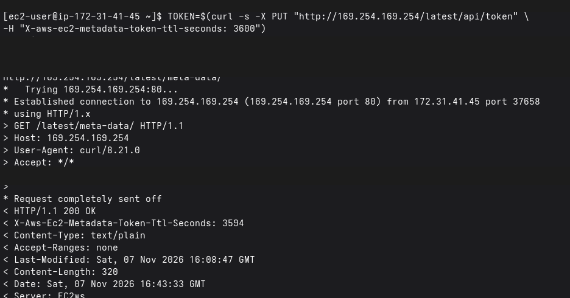
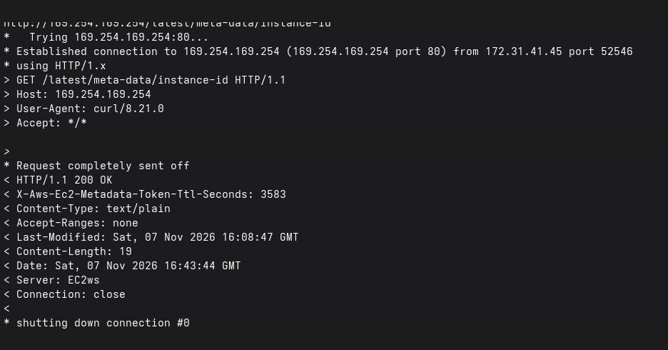
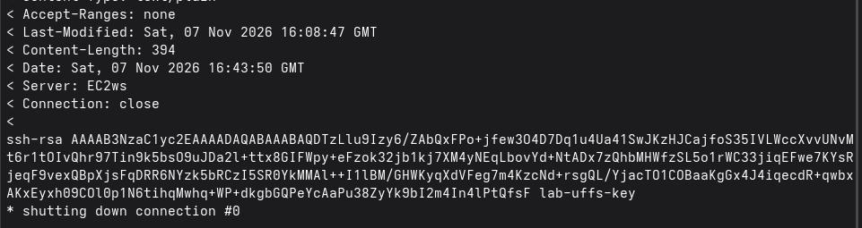

<p align="center">
  <a href="../../README.md"></a>
</p>

<div align="center">

<h2>04 · Explorando metadados EC2</h2>

<a href="../console/README.md"></a>
<a href="../launch/README.md"></a>
<a href="../connect/README.md"></a>

<a href="../terminate/README.md"></a>

</div>

## Visão geral

O Instance Metadata Service (IMDS) permite consultar informações de uma instância EC2 diretamente pelo sistema operacional

Nesta etapa, vamos utilizar o terminal Linux e o `curl` para explorar esses dados

## Instruções

### 1. Gere um token de acesso

No terminal da instância EC2, execute:

```bash
TOKEN=$(curl -fsS -X PUT \
  "http://169.254.169.254/latest/api/token" \
  -H "X-aws-ec2-metadata-token-ttl-seconds: 3600")
```

O token temporário autoriza as consultas IMDSv2 e fica armazenado na variável `TOKEN`

Execute os comandos dentro da instância EC2. Não use `echo "$TOKEN"` nem `curl -v`: o modo verbose mostra o token no cabeçalho HTTP. Não compartilhe o token nem o inclua em capturas ou logs

### 2. Liste os metadados disponíveis

Execute:

```bash
curl -fsS -w '\n' \
  -H "X-aws-ec2-metadata-token: $TOKEN" \
  http://169.254.169.254/latest/meta-data/
```

O terminal exibirá os caminhos de metadados disponíveis para a instância



O endereço `169.254.169.254` é utilizado para consultar metadados a partir da própria instância EC2

### 3. Consulte informações da instância

Vamos explorar alguns dos dados retornados pelo serviço

**Tipo de instância**

```bash
curl -fsS -w '\n' \
  -H "X-aws-ec2-metadata-token: $TOKEN" \
  http://169.254.169.254/latest/meta-data/instance-type
```

**Grupos de segurança**

```bash
curl -fsS -w '\n' \
  -H "X-aws-ec2-metadata-token: $TOKEN" \
  http://169.254.169.254/latest/meta-data/security-groups
```

**Identificador da AMI**

```bash
curl -fsS -w '\n' \
  -H "X-aws-ec2-metadata-token: $TOKEN" \
  http://169.254.169.254/latest/meta-data/ami-id
```

**Hostname**

```bash
curl -fsS -w '\n' \
  -H "X-aws-ec2-metadata-token: $TOKEN" \
  http://169.254.169.254/latest/meta-data/hostname
```

**Identificador da instância**

```bash
curl -fsS -w '\n' \
  -H "X-aws-ec2-metadata-token: $TOKEN" \
  http://169.254.169.254/latest/meta-data/instance-id
```

Cada comando retorna uma informação específica sobre o servidor. O identificador da instância pode ser diferente em cada execução



### 4. Consulte a chave pública SSH

Para visualizar a chave pública associada ao par de chaves da instância, execute:

```bash
curl -fsS -w '\n' \
  -H "X-aws-ec2-metadata-token: $TOKEN" \
  http://169.254.169.254/latest/meta-data/public-keys/0/openssh-key
```

O resultado apresenta a chave pública no formato OpenSSH, quando disponível. Essa chave é pública; não confunda com o arquivo privado `.pem`



> A chave pública pode ser consultada. A chave privada `.pem` e o token IMDSv2 devem permanecer protegidos

### 5. Encerre a sessão de metadados

Quando terminar, remova o token da variável da sessão:

```bash
unset TOKEN
```

## Verificação

Confirme que conseguiu consultar o tipo, o identificador e os demais metadados disponíveis da instância

<details>
<summary>Concluiu esta etapa? 🎉</summary>

<div align="center">


Você explorou os metadados da sua instância EC2

</div>

</details>

---

<table width="100%">
  <tr>
    <td><a href="../connect/README.md"></a></td>
    <td align="right"><a href="../terminate/README.md"></a></td>
  </tr>
</table>
