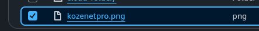
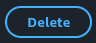
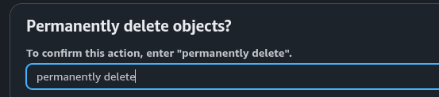
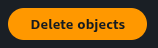
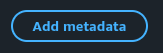
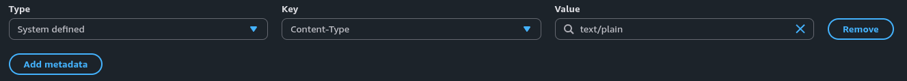
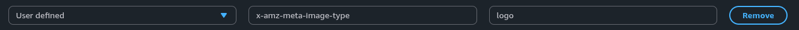
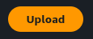
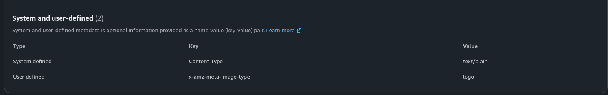

  

<h2>06 · Gerenciando metadados no Amazon S3</h2>

## Visão geral

Os metadados do Amazon S3 são informações armazenadas como pares de chave e valor e ajudam a descrever os objetos

Nesta etapa, vamos reenviar o arquivo de teste com metadados de sistema e uma informação personalizada

> Esta etapa substitui o objeto de teste enviado anteriormente. Mantenha uma cópia local do arquivo antes de removê-lo

## Instruções

### 1. Remova o objeto de teste

No Amazon S3, abra seu bucket e acesse `cloud-folder/`

Selecione somente o arquivo de teste usado nas etapas anteriores e clique em **Delete**

Na tela de confirmação, digite `permanently delete`

Clique em **Delete objects** para confirmar

> Exclua somente o objeto de teste. Não exclua o bucket nem outros arquivos

### 2. Envie o arquivo novamente

Retorne à pasta `cloud-folder/` e inicie um upload

Clique em **Upload → Add files** e selecione a cópia local do mesmo arquivo

Antes de concluir o upload, localize a seção **Properties → Metadata**

### 3. Configure os metadados

Clique em **Add metadata**

Em **System defined**, selecione **Content-Type**

Use um tipo de conteúdo que corresponda ao arquivo:

- Para a imagem PNG deste laboratório, use `image/png`
- Use `text/plain` somente para um arquivo de texto

A captura de exemplo mostra `text/plain`; não use esse valor para uma imagem PNG

Clique em **Add metadata** para adicionar um registro personalizado

Em **Type**, selecione **User defined** e informe a chave e o valor:

| Campo | Valor |
|---|---|
| Key | `x-amz-meta-image-type` |
| Value | `logo` |

O prefixo `x-amz-meta-` identifica metadados definidos pelo usuário no Amazon S3

### 4. Conclua o upload

Confira o nome do arquivo e os metadados. Clique em **Upload** e aguarde a confirmação

Depois, selecione **Close** e abra o objeto enviado

## Verificação

Na página do objeto, abra **Properties → Metadata**

Confirme que os metadados estão associados ao objeto. O `Content-Type` esperado depende do arquivo enviado; a captura mostra `text/plain` como exemplo

O objeto permanece privado, a menos que uma política ou outra configuração permita acesso público

Concluiu esta etapa? 🎉

Você configurou metadados de sistema e personalizados no Amazon S3

---

<table width="100%">
  <tr>
    <td></td>
    <td align="right"></td>
  </tr>
</table>
