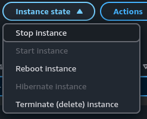
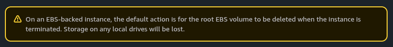

  

<h2>05 · Encerrando uma instância EC2</h2>

## Visão geral

Ao finalizar um laboratório na AWS, é importante encerrar os recursos que não serão mais utilizados

Nesta etapa, vamos terminar a instância EC2 criada para o laboratório e confirmar que ela chegou ao estado `Terminated`

> **Atenção:** terminar uma instância é uma ação permanente e não pode ser desfeita. Os dados do volume raiz EBS podem ser excluídos conforme a opção **Delete on termination**; confira as configurações de armazenamento antes de continuar. Outros volumes EBS podem permanecer e continuar gerando custos

## Instruções

### 1. Localize sua instância

No AWS Console, abra **EC2 → Instances** e selecione a instância deste laboratório

Confira o nome ou outro identificador da instância selecionada antes de prosseguir. Não termine outras instâncias da conta

### 2. Solicite o encerramento

Com a instância correta selecionada, abra o menu **Instance state**

Escolha **Terminate (delete) instance**. Não escolha **Stop instance** se o objetivo for encerrar permanentemente o recurso

### 3. Confirme a operação

Leia o aviso e confirme que selecionou a instância correta e que não precisa dos dados que serão excluídos

Se tiver certeza, clique em **Terminate (delete)**

### 4. Verifique o estado

Aguarde o Console atualizar o estado. Ele pode passar por:

`Running → Shutting-down → Terminated`

## Verificação

Na lista **Instances**, confirme que **Instance state** da instância selecionada apresenta `Terminated`. A atualização pode levar alguns instantes

Depois, confira **Volumes** e outros recursos relacionados para garantir que não restaram recursos que você não pretende manter

Qual a diferença entre Stop e Terminate?

- **Stop:** desliga a instância, permitindo iniciá-la novamente. Os volumes EBS continuam existindo e podem gerar custos
- **Terminate:** encerra permanentemente a instância. O volume raiz EBS é excluído se **Delete on termination** estiver habilitado; outros volumes EBS podem permanecer

Laboratório concluído! 🎉

### Parabéns, Builder!

Você concluiu seu primeiro laboratório Amazon EC2

Criou uma instância, conectou-se ao servidor Linux, explorou seus metadados e encerrou os recursos utilizados

**[Voltar ao laboratório](../../README.md)**

---

<table width="100%">
  <tr>
    <td></td>
    <td align="right"></td>
  </tr>
</table>
