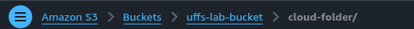
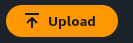
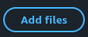
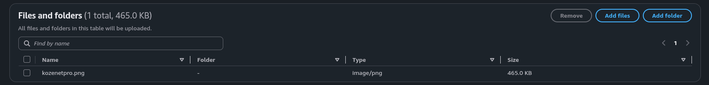
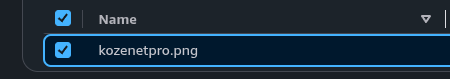
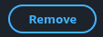
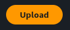
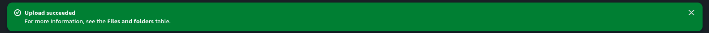
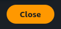
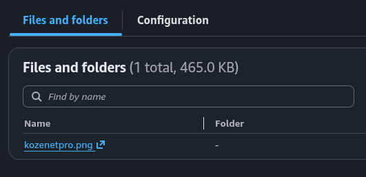

<p align="center">
  <a href="../../README.md"></a>
</p>

<div align="center">
<h2>04 · Enviando arquivos para o Amazon S3</h2>

<a href="../console/README.md"></a>
<a href="../bucket/README.md"></a>
<a href="../folder/README.md"></a>

<a href="../access/README.md"></a>
<a href="../metadata/README.md"></a>
<a href="../delete/README.md"></a>

</div>

## Visão geral

O Amazon S3 armazena arquivos como objetos, identificados por uma chave dentro de um bucket

Nesta etapa, vamos enviar um arquivo de teste para a pasta criada anteriormente

## Instruções

### 1. Abra a pasta

No Amazon S3, acesse seu bucket e clique em `cloud-folder/`

Confira o caminho de navegação para confirmar que está dentro do bucket e da pasta corretos



### 2. Adicione um arquivo

Dentro da pasta, clique em **Upload**



Na página de envio, clique em **Add files** e selecione um arquivo de teste no seu computador



Confirme que o arquivo aparece na lista **Files and folders**



Se necessário, marque a caixa ao lado do arquivo para selecioná-lo. O botão **Remove** serve para retirar um arquivo da lista antes do envio





### 3. Envie o arquivo

Clique em **Upload** e aguarde a mensagem de confirmação





Clique em **Close** para retornar à pasta



## Verificação

Abra `cloud-folder/` e confirme que o arquivo aparece na aba **Files and folders**



O caminho do objeto terá este formato

```text
s3://nome-do-bucket/cloud-folder/nome-do-arquivo
```

<details>
<summary>Concluiu esta etapa? 🎉</summary>

<div align="center">


Seu arquivo está armazenado no Amazon S3

</div>

</details>

---

<table width="100%">
  <tr>
    <td><a href="../folder/README.md"></a></td>
    <td align="right"><a href="../access/README.md"></a></td>
  </tr>
</table>
